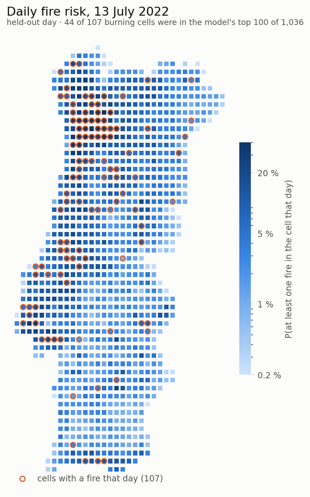
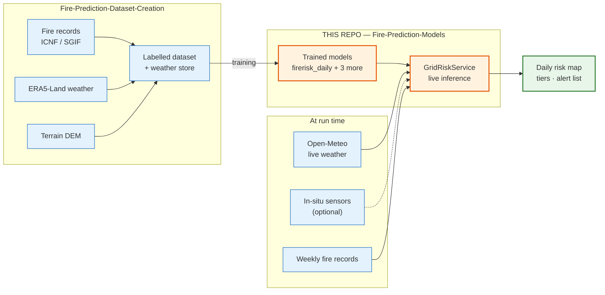
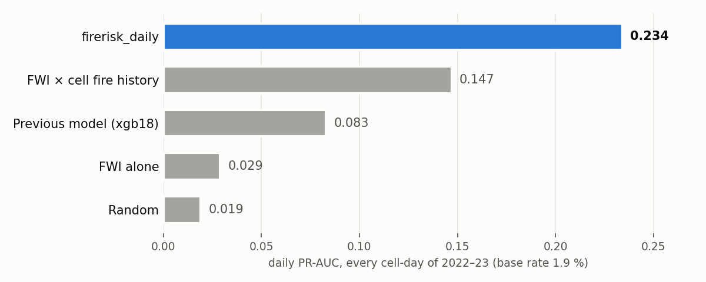
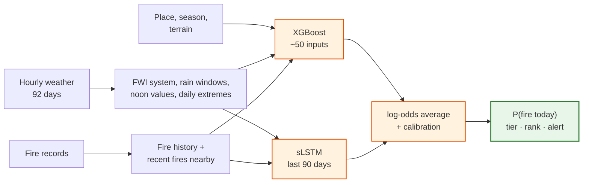

<h1 align="center">Fire-Prediction Models</h1>

<p align="center">
  <em>Daily wildfire-ignition risk for every ~10 km square of Portugal, from live weather
  or in-situ sensors, with trained models you can run in one line.</em>
</p>

<p align="center">
  
  
  
  
  
</p>

<p align="center">
  <picture>
    <source media="(prefers-color-scheme: dark)" srcset="assets/risk_map_dark.png">
    
  </picture>
  <br>
  <sub>A held-out day: 13 July 2022, scored by a model trained only on 2014–2021.
  44 of the 107 cells that burned were in its top 100 of 1,036.</sub>
</p>

---

## What this is

This repository ships the **trained fire-risk models** and the **service that runs
them**. Every day, for each of Portugal's 1,036 grid cells, it answers one question:

> **How likely is it that at least one wildfire starts in this cell today, and tomorrow?**

| You get | |
|---|---|
| **A calibrated probability** per cell and day | "4 % chance of a fire here today", not just a score |
| **A risk tier** | low · moderate · high · very high · extreme |
| **A bounded alert list** | the 25 riskiest cells of the country each day |
| **The drivers** | fire-danger index (FWI), drought code, 30-day rain, days since rain, daily extremes |

It runs on **live Open-Meteo weather** out of the box, and can take **in-situ sensor
readings** for the cells that have sensors. It can score the **whole country** in
~2.5 min or **one square** in ~5 s.

### Where it fits



The training data comes from the companion repository,
**[Fire-Prediction-Dataset-Creation](https://github.com/PedroMattaMPT/Fire-Prediction-Dataset-Creation)**,
which builds the labelled fire / no-fire dataset. This repository starts where that
one stops: trained models and inference.

---

## Quickstart

```bash
# 1. Clone (the models and the serving data come with it, ~25 MB)
git clone https://github.com/PedroMattaMPT/Fire-Prediction-Models.git
cd Fire-Prediction-Models

# 2. Create an environment (Python 3.12+) and install
python -m venv .venv
source .venv/bin/activate
pip install torch --index-url https://download.pytorch.org/whl/cpu   # CPU build is enough
pip install -r requirements.txt

# 3. Today's risk for one square (~5 s)
python examples/grid_daily_risk.py --point 40.12,-7.48 --model firerisk_daily_norecency

# 4. The whole country + the alert list (the first run takes ~15 min, then ~2.5 min a day)
python examples/grid_daily_risk.py --model firerisk_daily_norecency
```

```text
firerisk_daily_norecency, cell 605 (40.12, -7.48); FWI state: climatology
       day  probability tier    fwi   ffmc      dc  rain_720h  days_since_rain
2026-10-13        0.016  low 11.699 88.933 552.844       40.2              6.0
2026-10-14        0.012  low 13.996 88.982 557.562       40.2              7.0
```

> [!IMPORTANT]
> **Feed recent fire records to use the main model.** `firerisk_daily` reads how
> recently each square and its neighbours burned, and the fire history shipped here
> ends in **2024**. Run without fresh records, it treats every square as quiet and
> **under-predicts**: in the square above it gives 0.3 % against 1.6 % from the
> no-recency model. So until you have a feed, use `firerisk_daily_norecency`, as the
> commands above do. Once you have one, add the records weekly and switch to
> `firerisk_daily`:

```python
import pandas as pd
from app.api.grid import GridRiskService

svc = GridRiskService()                                  # firerisk_daily
svc.add_fires(pd.DataFrame({"t": times_utc, "lat": lats, "lon": lons}))   # e.g. last weeks' ICNF / ANEPC records
run = svc.run()                                          # every square, today + tomorrow
run.daily.query("alert")                                 # today's 25-square alert list
run.daily[["cell", "probability", "tier", "fwi"]].head()
```

> **Open-Meteo budget.** The free tier allows 600 location-calls a minute. The first
> national run downloads ~85 days of history for every cell (~6–7 k calls, ~15 min,
> once). After that a daily run costs ~1 call per cell, and a one-square run a handful.
> The service paces itself and retries outages.

---

## The three choices

There is **one model and one call**. Every run combines three independent choices.

| Choice | Options | Call |
|---|---|---|
| **1 · Which squares** | the whole country *(default)* · only the ones you ask for | `run()` · `run(points=[(lat, lon)])` |
| **2 · Weather source** | Open-Meteo *(default)* · in-situ sensors, with Open-Meteo filling every gap | `run()` · `run(observations=obs)` |
| **3 · Sensor variables** | everything the sensors send *(default)* · only the ones you trust | `run(observations=obs, sensor_variables=("temp", "humidity"))` |

```python
svc.run()                                                          # country, Open-Meteo
svc.run(observations=obs)                                          # country, sensors where available
svc.run(observations=obs, sensor_variables=("temp", "humidity"))   # ...only T/RH from sensors
svc.run(points=[(40.12, -7.48)])                                   # one square
svc.run(points=[(40.12, -7.48)], observations=obs)                 # one square with its sensors
```

<details>
<summary><b>Whole country vs selected squares</b></summary>

| | Whole country | Selected squares |
|---|---|---|
| Squares | all 1,036 | only those asked for |
| Probability, tier | yes | yes, identical to a national run |
| National rank, top-25 alert | yes | no: that needs every square, so use the tier or `AlertPolicy("tiers")` |
| Time | ~2.5 min a day (15 min the first time) | ~5 s |
| Shared state | writes the FWI state and the feed cache | reads only, safe to run alongside |

</details>

<details>
<summary><b>Where each weather variable comes from</b></summary>

| Call | Temperature, humidity | Wind | Rain |
|---|---|---|---|
| `run()` | Open-Meteo | Open-Meteo | Open-Meteo |
| `run(observations=obs)` | sensor | sensor if measured | sensor if measured |
| `… sensor_variables=("temp", "humidity")` | sensor | Open-Meteo | Open-Meteo |
| a square without a sensor, or a missed hour | Open-Meteo | Open-Meteo | Open-Meteo |

The model **always receives all of its inputs**. The choice sets where each one comes
from. Dropping a variable instead would cost skill (rain alone is worth 10 %), so a
missing variable is filled from Open-Meteo.

</details>

---

## Feeding sensors

Send a plain table, one row per sensor and hour, covering the last 92 days:

| `time` | `lat` | `lon` | `temp` | `humidity` | `wind_speed` | `precip` |
|---|---|---|---|---|---|---|
| UTC hour | ° | ° | °C | % | km/h, 10 m *(optional)* | mm in the hour *(optional)* |

```python
run = svc.run(observations=obs)
run.observed          # per square: hours taken from each sensor variable
```

Several sensors in one square are combined by their median, and out-of-range values
fall back to Open-Meteo. Dew point and humidity are each derived from the other when
only one is sent. Before sending: drop data from before a sensor's deployment date,
glitch and frozen readings; convert rain counters to hourly amounts and wind to km/h.
`firepredict/sensors.py` does all of this for the SenForFire database. The full
contract is in **[docs/sensor-integration.md](docs/sensor-integration.md)**.

---

## Performance

Judged on **every cell and every day** of years the model never saw (about 2
cell-days in 100 have a fire), not on a balanced test set:

<p align="center">
  <picture>
    <source media="(prefers-color-scheme: dark)" srcset="assets/skill_dark.png">
    
  </picture>
</p>

| On every cell-day of 2022–23 | Random | FWI × fire history | Previous model | **firerisk_daily** |
|---|---|---|---|---|
| Daily PR-AUC | 0.019 | 0.147 | 0.083 | **0.234** |
| ROC-AUC | 0.50 | 0.85 | 0.80 | **0.894** |
| Fires among the 10 riskiest cells each day | 0.2 | 1.6 | 0.6 | **1.97** |
| Fire rate in the riskiest 1 % of cell-days | 2 % | 27 % | 17 % | **38 %** |
| Median rank of a ≥ 100 ha fire's cell (of 1,036) | #518 | #203 | #302 | **#125** |

- **It beats the fire-danger index combined with fire history in every year from 2019
  to 2023.** Each year is scored by a model trained only on the years before it
  (PR-AUC 0.200 · 0.251 · 0.188 · 0.261 · 0.197).
- **With the default 25 alerts a day**, about 1 in 6 alerts is a real fire (precision
  16.4 %) and 1 in 5 burning cells is flagged (recall 20.7 %).
- **Sensors give the same skill as gridded weather.** On weather-station cells,
  2019–22: 0.147 vs 0.146, with a 95 % interval that includes zero. No correction or
  retraining is needed.

> **Why not 0.9?** Published wildfire models often report AUPRC ≈ 0.85, but on test
> sets with one fire for every two non-fires, where a random guess scores 0.33. On the
> real 2 % base rate a random guess scores 0.02, so 0.234 is about 12× random. See
> [docs/how-it-works.md §6](docs/how-it-works.md#6-how-it-compares-with-published-work).

---

## How it works



1. **Weather:** five measurements (temperature, dew point, humidity, wind, rain)
   become noon values, daily extremes, the Canadian Fire Weather Index system and rain
   totals over 1–90 days.
2. **Fire records:** how often the cell burns, and how recently it and its neighbours
   burned. This was the single biggest gain.
3. **Place, season and terrain**, stated explicitly rather than inferred from weather.
4. **Two models, one answer:** XGBoost reads today's ~50 inputs, an sLSTM reads the
   last 90 days, and their average is calibrated into a probability.

Trained on every registered fire of 2014–2023 (85,306 fire cell-days). Details:
**[docs/how-it-works.md](docs/how-it-works.md)**.

---

## The models

| Model | Predicts | Use |
|---|---|---|
| **`firerisk_daily`** | P(≥ 1 fire in the cell today) | the main product (XGBoost + sLSTM) |
| `firerisk_daily_norecency` | the same, without recent-fire inputs | **out of the box**, until recent fire records reach the service |
| `firerisk_hourly` | P(≥ 1 fire in the cell this hour) | an hourly layer |
| `largefire_daily` | P(a fire reaching 10 ha today) | where fires that escape first attack are likely |

```python
svc = GridRiskService("largefire_daily")
```

Each model has a JSON card beside it in `outputs/models/grid/`, listing its features,
training period, calibration and feature importance.

---

## Repository layout

```
Fire-Prediction-Models/
├── app/api/
│   ├── grid.py                  # GridRiskService — the live service (start here)
│   ├── alerts.py                # AlertPolicy — top-k, adaptive, tiers
│   └── openmeteo.py             # Open-Meteo -> model inputs
├── firepredict/                 # the model code: features, FWI, grid models, sensors
│   ├── features.py              #   the ~50 inputs, built the same way in training and serving
│   ├── fwi.py                   #   Canadian Fire Weather Index system
│   ├── grid_models.py           #   the XGBoost model, training and calibration
│   ├── grid_neural.py           #   the sLSTM member
│   └── sensors.py               #   SenForFire sensor client + quality checks
├── outputs/
│   ├── models/grid/             # the 4 trained models + their JSON cards
│   └── store/portugal/          # serving pack: grid, terrain, FWI climatology, fire history
├── examples/
│   ├── grid_daily_risk.py       # national map / one square (--point lat,lon)
│   └── grid_with_sensors.py     # the same with sensor readings
├── evaluation/                  # the reports behind every number in this README
├── scripts/                     # evaluation harness and experiments (need the full weather store)
├── docs/                        # the guides
└── assets/                      # README figures
```

---

## Documentation

| Guide | What it covers |
|---|---|
| [**usage.md**](docs/usage.md) | every option of `GridRiskService` and `run()`, the output columns, alerts, models, operating notes, troubleshooting |
| [**sensor-integration.md**](docs/sensor-integration.md) | the observations table, choosing sensor variables, data checks, what to expect |
| [**how-it-works.md**](docs/how-it-works.md) | inputs, model, training, evaluation protocol, results per year, comparison with published work, limits |
| [**sensors.md**](docs/sensors.md) | the evidence: SenForFire sensors vs Open-Meteo, and the model fed sensors vs gridded weather |

---

## Limits

- **Probabilities are approximate** (up to ~33 % off on 2022–23); the **ranking** is
  reliable.
- **Large fires** are harder to see coming than small ones.
- **Recent-fire inputs need a weekly fire feed** (`svc.add_fires`); otherwise use
  `firerisk_daily_norecency`.
- **Portugal only:** the code is region-agnostic, but the models are trained on
  Portugal's grid.

---

## Related

- **[Fire-Prediction-Dataset-Creation](https://github.com/PedroMattaMPT/Fire-Prediction-Dataset-Creation)**:
  the pipeline that builds the labelled fire / no-fire dataset from fire records,
  ERA5-Land weather and terrain.

## Star this project

If this is useful to you, please consider leaving a star. It helps others discover the
project.

## License

MIT — see [LICENSE](LICENSE).
