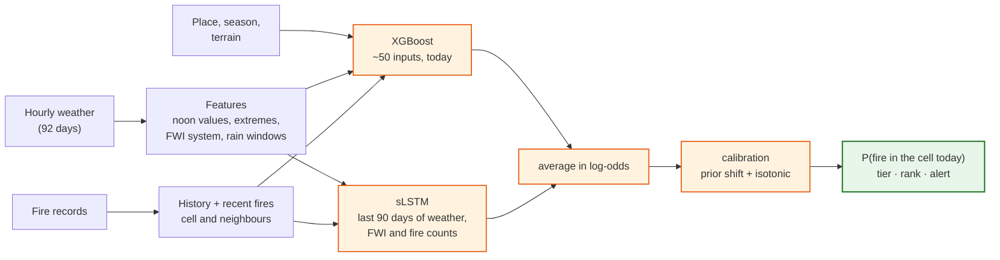

# How the model works

`firerisk_daily` gives, for each ~10 km cell of Portugal (1,036 cells) and each day,
the probability that at least one wildfire starts there. This page covers what it
reads, how it was trained, how it was judged, and where it falls short.

## 1. Inputs

About 50 numbers per cell and day, in four families. Only five raw weather
measurements enter: temperature, dew point, humidity, wind and rain. Everything else
is computed from them, from the fire records, or is fixed.

| Family | Inputs | Source |
|---|---|---|
| **Weather** (5 + 4) | noon temperature, humidity, wind, 24 h rain, vapour-pressure deficit; the day's max temperature, min humidity, max wind, max VPD | Open-Meteo or in-situ sensors |
| **Fire danger** (6) | the Canadian Fire Weather Index system: FFMC, DMC, DC, ISI, BUI, FWI (the index IPMA publishes) | computed from the weather, state carried day to day |
| **Dryness** (6) | rain over 1, 3, 7, 30 and 90 days; days since the last rain day | computed from the weather |
| **Fire history** (2) | how often the cell burns, overall and in this calendar month | fire registry |
| **Recent fires** (2 + 7 + 4) | days since the cell burned, fires in the past year; the same for the surrounding cells; a "fire pressure" score from recent fires fading over 7/30 days and 10/30 km | fire registry, fires ≥ 7 days old |
| **Place and season** (6) | latitude, longitude, day of year, weekday, public holiday | built in |
| **Terrain** (8) | slope (mean, spread, 90th percentile), roughness, how much of the cell faces south | Copernicus DEM, whole-cell statistics |

Two design rules:

- **Time and place are explicit.** Earlier models had to infer the season and the
  location from weather proxies (pressure, soil moisture). Telling the model the
  obvious things was worth more than any weather variable.
- **Only feed-robust weather.** Pressure, soil moisture and surface fluxes were
  dropped, because Open-Meteo reports them differently from the ERA5-Land data the
  model learned from (pressure is off by 2.1 standard deviations). The five
  variables kept agree closely: FWI from the feed has r = 0.95 with the training data.

## 2. The model

- **XGBoost** reads the ~50 inputs of the day.
- **sLSTM** (a recurrent network) reads how the last 90 days evolved, which captures
  trends such as a drought building or a heatwave arriving.
- Their answers are **averaged in log-odds**, then **calibrated**: an exact prior-shift
  correction for the training sampling, then isotonic regression fitted on a held-out
  validation year. The output is a probability, not just a score.

## 3. Training

- **Data:** every registered fire of 2014–2023 (85,306 fire cell-days, ICNF/SGIF
  registry, rekindles excluded) on ERA5-Land weather, with the weather store built by
  the [dataset pipeline](https://github.com/PedroMattaMPT/Fire-Prediction-Dataset-Creation).
- **Negatives:** case-base sampling. Cell-days are drawn uniformly at 20 per fire,
  rejecting only those with a registered fire. The sampling ratio is exact, so scores
  convert back to probabilities.
- **Validation:** early stopping and calibration use the last year before the test
  period, never the test period itself.

## 4. How it was judged

Most published fire models are scored on a test set balanced between fires and
non-fires. There a random guess already reaches AUPRC 0.33, and nearly any model
looks good. This model is judged the way it will be used:

- **every cell and every day** of held-out years (base rate: about 2 cell-days in
  100 have a fire);
- **rolling origin:** each test year is scored by a model trained only on the years
  before it;
- **against baselines** (FWI alone, a climatology of place + season + fire history,
  FWI × cell fire history, the previous models), with paired day-block bootstrap
  intervals.

## 5. Results

On every cell-day of 2022–23:

| Model | Daily PR-AUC | ROC-AUC | Fires in the top 10 cells/day | Fire rate in the riskiest 1 % | Median rank of a ≥ 100 ha fire's cell |
|---|---|---|---|---|---|
| Random | 0.019 | 0.50 | 0.2 | 2 % | #518 |
| FWI alone | 0.029 | 0.66 | 0.1 | 3 % | #640 |
| Previous model (`xgb18`) | 0.083 | 0.80 | 0.6 | 17 % | #302 |
| FWI × cell fire history | 0.147 | 0.85 | 1.6 | 27 % | #203 |
| **`firerisk_daily`** | **0.234** | **0.894** | **1.97** | **38 %** | **#125** |

Every held-out year, each scored by a model trained on the years before it:

| Test year | 2019 | 2020 | 2021 | 2022 | 2023 |
|---|---|---|---|---|---|
| `firerisk_daily` PR-AUC | **0.200** | **0.251** | **0.188** | **0.261** | **0.197** |
| FWI × cell fire history | 0.153 | 0.218 | 0.132 | 0.175 | 0.125 |
| `firerisk_daily` ROC-AUC | 0.871 | 0.902 | 0.880 | 0.894 | 0.894 |

**What drives the skill.** The single biggest gain came from the recent-fire inputs
(+0.029 PR-AUC). The neighbour and fire-pressure inputs add a little more in every
year, and the sLSTM adds +0.011. Removing weather inputs shows how much they carry
(XGBoost member, 2022–23):

| Weather the model gets | PR-AUC |
|---|---|
| all of it | 0.223 |
| without wind | 0.221 |
| without rain | 0.200 |
| temperature + humidity only | 0.199 |
| none | 0.153 |

So weather matters, rain most of all, but fire history and place carry a large share.
This is why missing sensor variables are filled from Open-Meteo rather than dropped.

**With sensors.** Fed point measurements from weather stations (2019–22, 57
station-years) instead of gridded weather, the model scores the same: 0.147 against
0.146, and the difference's 95 % interval includes zero. See [sensors.md](sensors.md).

The reports behind every number are in [`evaluation/`](../evaluation/).

## 6. How it compares with published work

Few published systems do the same task, and fewer are scored on the full
distribution:

| System | Task | Reported | Comparable? |
|---|---|---|---|
| ECMWF / CEMS Probability of Fire (McNorton et al. 2024) | daily P(satellite fire detection), 9 km, global | ROC-AUC 0.818 on all land cell-days | closest protocol, but a different target (MODIS detections, not ignitions) and global |
| Mesogeos track A (Kondylatos et al., NeurIPS 2023) | next-day danger, fires > 30 ha, Mediterranean 1 km | AUPRC 0.85 | no: a 1 fire : 2 non-fire test set (random = 0.33) |
| IberFire (2025) | daily occurrence, Spain 1 km | AUC 0.955 | no: balanced test, random negatives |
| IPMA RCM, EFFIS FWI | fire-danger classes / index | no skill published | — |

On a 2 % base rate, PR-AUC 0.234 is about 12× random. A balanced-test AUPRC of 0.85
is about 2.6× random.

## 7. Limits

- **Probabilities are approximate:** up to ~33 % off on 2022–23 (6–57 % by year,
  against a 20 % goal). The ranking is reliable.
- **Large fires are harder** to see coming than small ones; `largefire_daily` targets
  them.
- **Recent fires need a feed.** Without weekly fire records the recency inputs go
  stale; use `firerisk_daily_norecency`.
- **Portugal only.** The code is region-agnostic, but the models are trained on
  Portugal's grid.
- **Sensor skill on the real network** can only be measured once the 2025–26 fire
  records are available.
